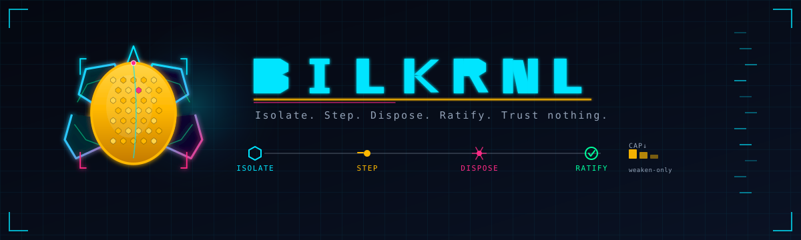
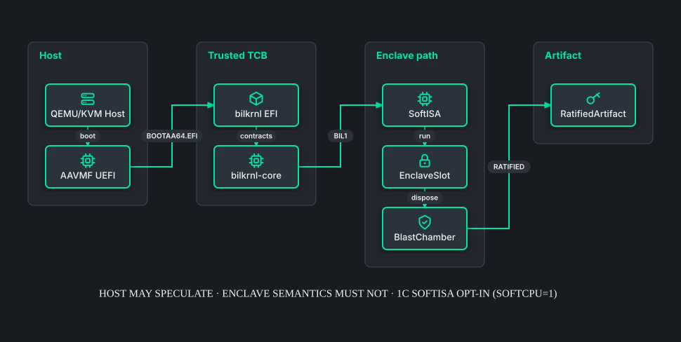
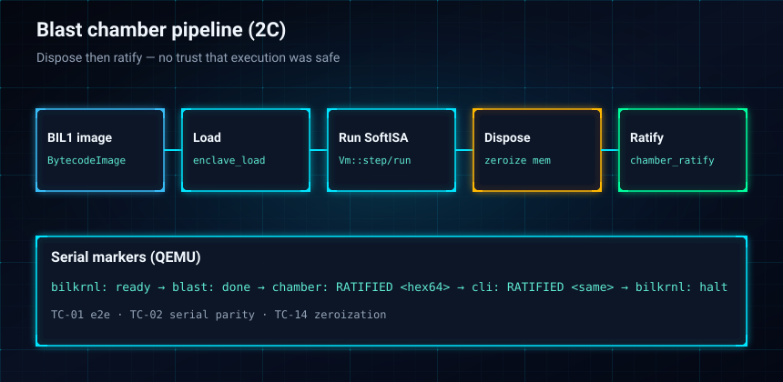
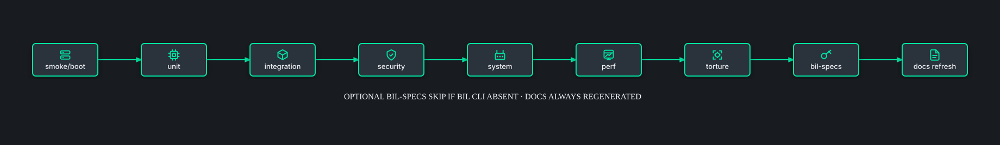
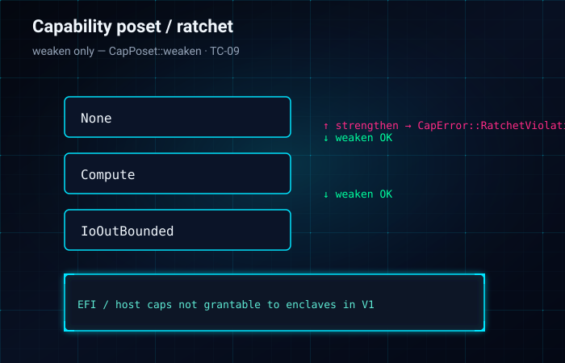

# bilkrnl

<p align="center">
  
</p>

> A research kernel that boots on UEFI aarch64 (QEMU/KVM), runs untrusted code on a **6502-style soft ISA** (linear address space, no speculative semantics), then **disposes** enclave state and **ratifies** outputs in a blast chamber.

This is not a micro-VM guest (Firecracker isolates a guest kernel; you still trust speculative GP CPUs). bilkrnl owns the TCB: capability poset/ratchet, deterministic stepping, and post-run distrust. Host CPUs may speculate; **enclave semantics must not**. Custom soft-CPU hardware (milestone **1C**) is deferred — see [`docs/roadmap/1c-softcpu.md`](docs/roadmap/1c-softcpu.md).

**Docs site:** [GitHub Pages](https://nonont1010.github.io/bilkrnl/) · [User manual](docs/usermanual/README.md)

---

## Visual Architecture & Workflow Showcase

Figures are generated with [**diagrams-as-code**](https://github.com/bsommers/diagrams-as-code) (`cyber_slate` theme). See [`docs/TOOLING.md`](docs/TOOLING.md). For interactive web charts later, [**lumagrid**](https://github.com/bsommers/lumagrid) is available.

| Graphic | What it shows |
|---------|----------------|
|  | Host → UEFI → TCB → SoftISA / Enclave / Chamber |
|  | Load → Run → Dispose → Ratify (2C) sequence |
|  | `scripts/verify.sh` layered gates including docs refresh |
|  | Capability poset: weaken-only ratchet (TC-09) |

---

## Quick Start

```bash
# Prerequisites: rustup target aarch64-unknown-uefi, qemu-system-aarch64, AAVMF
rustup target add aarch64-unknown-uefi
sudo apt-get install -y qemu-system-arm qemu-efi-aarch64 inkscape   # inkscape for docs PNGs

# Full verify (build + QEMU e2e + docs refresh)
./scripts/verify.sh

# Interactive serial console
cargo build -p bilkrnl --target aarch64-unknown-uefi --release
INTERACTIVE=1 ./scripts/run-qemu.sh
```

You should see `bilkrnl: ready`, then `chamber: RATIFIED <digest>`, matching `cli: RATIFIED <digest>`, then `bilkrnl: halt`.

---

## What It Does

- **UEFI boots** on QEMU `virt` aarch64 via AAVMF (`BOOTAA64.EFI`)
- **Soft ISA** executes `BIL1` bytecode with direct `Vm::step` (no branch prefetch)
- **Enclaves** are single-flight: `load` → `run` → mandatory `dispose` (zeroize)
- **Blast chamber (2C)** ratifies exits, budgets, caps ceiling, and out predicates
- **Capability ratchet** allows only weaken (`None` < `Compute` < `IoOutBounded`)
- **Verify matrix** covers TC-01..TC-15 across unit/integration/security/system/perf/torture

---

## Architecture Overview

```
QEMU/KVM aarch64 virt
       │ UEFI (AAVMF)
       ▼
 bilkrnl TCB ──► EnclaveLoad(BIL1)
       │              │
       │         SoftISA Vm::run
       │              │
       │         Dispose (zeroize)
       │              │
       └────► chamber_ratify ──► Ratified | Reject
```

Details: [`docs/ARCHITECTURE.md`](docs/ARCHITECTURE.md) · purpose: [`docs/PURPOSE.md`](docs/PURPOSE.md)

---

## Project Structure

```
bilkrnl/
├── bilkrnl-core/     — caps, ISA, enclave, chamber (no_std + host tests)
├── kernel/           — UEFI entry, serial CLI
├── tests/            — exhaustive matrix by tier
├── scripts/          — verify.sh, run-qemu.sh, render-graphics.py
├── docs/             — architecture, how-to, Pages site, assets
├── assets/logo.svg   — square brand mark
└── docs/roadmap/     — 1C soft-CPU (deferred)
```

---

## Configuration

| Variable | Required | Default | Description |
|----------|----------|---------|-------------|
| `BUILD_MODE` | No | `release` | Kernel profile for `run-qemu.sh` |
| `FIRMWARE_CODE` | No | `/usr/share/AAVMF/AAVMF_CODE.fd` | UEFI code flash |
| `TIMEOUT_SEC` | No | `30` / `45` | QEMU wall timeout |
| `SERIAL_LOG` | No | `target/qemu-serial.log` | Captured serial |
| `INTERACTIVE` | No | `0` | `1` = attach console |

---

## Development

```bash
./scripts/verify.sh --quick          # unit + kernel build + 1C roadmap
./scripts/verify.sh                  # full tiers + docs refresh
./scripts/verify.sh --only chamber   # chamber unit + host e2e
python3 scripts/render-graphics.py   # regenerate docs/assets
```

---

## Documentation

| Document | Description |
|----------|-------------|
| [Purpose](docs/PURPOSE.md) | Why bilkrnl exists, goals, non-goals |
| [Architecture](docs/ARCHITECTURE.md) | Components, contracts, data flow |
| [How-To](docs/HOWTO.md) | Boot, author BIL1, extend ISA, debug |
| [Running](docs/running.md) | QEMU/KVM recipes |
| [Testing](docs/TESTING.md) | TC matrix ↔ verify tiers |
| [Evidence](docs/EVIDENCE.md) | What green verify proves |
| [User manual](docs/usermanual/README.md) | Operator-oriented guide |
| [1C roadmap](docs/roadmap/1c-softcpu.md) | Deferred soft-CPU |
| [bil integration](docs/roadmap/bil-integration.md) | Host-side [bsommers/bil](https://github.com/bsommers/bil) specs |
| [enclave_chamber.bil](specs/bil/enclave_chamber.bil) | Model-checked enclave/chamber lifecycle |

---

## Formal specs (optional)

With [`bil`](https://github.com/bsommers/bil) on `PATH` (or `BIL_BIN`):

```bash
./scripts/verify.sh --only bil-specs
```

---

## License

MIT — see package metadata in workspace `Cargo.toml`.
