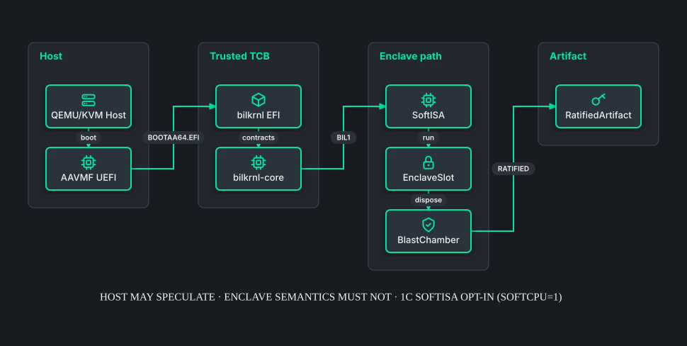
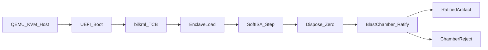

# Architecture

## Layers

| Layer | Path | Role |
|-------|------|------|
| Host | QEMU `virt` aarch64 + AAVMF | Speculative GP CPU (accepted) |
| Boot | `kernel/` UEFI app | `bilkrnl: ready`, demo blast, serial CLI |
| Core | `bilkrnl-core/` | Caps, SoftISA, enclave, chamber (`no_std`) |
| Verify | `scripts/verify.sh` | Tiered gates + docs refresh |
| Specs (host) | `specs/bil/` + [bsommers/bil](https://github.com/bsommers/bil) | Model-check enclave/chamber invariants (not in UEFI TCB) |

## Data flow

## Core contracts

### `BytecodeImage` (`BIL1`)

32-byte header: magic `BIL1`, entry `u32`, code length, cap byte, `max_cycles`, `max_out_bytes`, `max_mem_pages`, then code bytes. Encode/decode in `bilkrnl-core::image`.

### SoftISA (`isa::Vm`)

- Linear RAM sized by `max_mem_pages * 4096` (ceiling 1 MiB).
- Acc + PC; opcodes `Halt/Nop/LoadImm/Load/Store/AddImm/SubImm/Jmp/Jz/Out/Weaken`.
- `0xE0..=0xEF` → `FaultKind::HostEscapeAttempt` (no host side effects).
- Every `step` charges one cycle; budget overrun → `ExitReason::BudgetExceeded`.

### Enclave lifecycle

`EnclaveSlot`: single-flight. Phases `Loaded` → `Ran` → `Disposed`. Second `load` while busy → `LoadError::Busy`. `dispose` is idempotent; `run` after dispose → `RunError::Disposed`. `blast()` = load→run→dispose.

### Blast chamber (2C)

`chamber_ratify(result, RatifySpec)` checks allowed exits, cycle/out ceilings, caps ceiling (`caps_at_exit ≤ required_caps_ceiling`), and `OutPred` (`ExactBytes` / `Sha256Eq` / `LenLe` / `Any`). Success yields `artifact_digest` over exit tag + cycles + out + digests.

### Capability poset

`None < Compute < IoOutBounded`. `CapPoset::weaken` only; strengthen → `RatchetViolation`. EFI caps are not in the enum for V1.

## Surfaces (uniform)

| Surface | Adapter |
|---------|---------|
| Core commands | `enclave_load/run/dispose`, `chamber_ratify`, `blast` |
| Serial CLI | `kernel/src/cli.rs` — help + `blast` parity |
| Host harness | `tests/` + `scripts/verify.sh` |
| Docs / Pages | `docs/index.html`, rendered assets |

Skipped V1: HTTP/MCP/GUI (no userspace network stack).

## Deferred: 1C soft-CPU

Replace interpreter body with QEMU device/RTL; keep `BIL1` and digests byte-identical. Tracked in [`roadmap/1c-softcpu.md`](roadmap/1c-softcpu.md).

## Formal specs via bil (Bounded Invariant Logic)

[bsommers/bil](https://github.com/bsommers/bil) is the host-side proof language for these contracts (`system` model-check, WP verify, optional Verus emit). See [`roadmap/bil-integration.md`](roadmap/bil-integration.md) and [`specs/bil/enclave_chamber.bil`](../specs/bil/enclave_chamber.bil). **bil is never linked into the UEFI kernel.**
