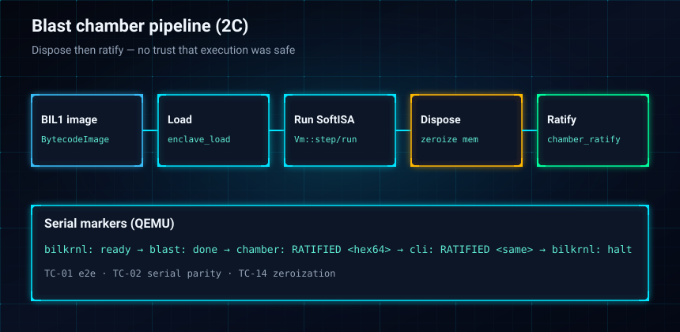

# How-To Guide



## Boot bilkrnl under QEMU

```bash
rustup target add aarch64-unknown-uefi
cargo build -p bilkrnl --target aarch64-unknown-uefi --release
./scripts/run-qemu.sh                 # non-interactive, writes target/qemu-serial.log
INTERACTIVE=1 ./scripts/run-qemu.sh   # attach serial
```

Expect markers: `bilkrnl: ready` → `chamber: RATIFIED` → `cli: RATIFIED` (same digest) → `bilkrnl: halt`.

## Host ratify gate (external consumer)

Treats `chamber: RATIFIED <digest>` as the sole go-signal. Exit 0 only if the digest matches the PASS golden in `tests/system/golden/policy_pass.artifact_digest`.

```bash
cargo build -p bilkrnl --target aarch64-unknown-uefi --release
./scripts/ratify-gate.sh --qemu          # build path already done; re-runs QEMU + checks
./scripts/ratify-gate.sh --log target/qemu-serial.log   # check an existing log
./scripts/verify.sh --only ratify-gate   # fixture negatives + optional live log
```

## Author a BIL1 program (host)

Prefer the assembler (B3.1):

```bash
cargo run -p bil1asm -- assemble tools/bil1asm/examples/policy_pass.bil1.ir -o /tmp/policy_pass.bil1
```

Or build an image in Rust from the sealed policy-gate fixture (kernel demo):

```rust
use bilkrnl_core::budget::ResourceBudget;
use bilkrnl_core::cap::Cap;
use bilkrnl_core::image::BytecodeImage;
use bilkrnl_core::isa::fixture_policy_pass_program;

let (entry, code) = fixture_policy_pass_program();
let img = BytecodeImage::new(
    entry,
    code, // allowlist walk → PASS\n → weaken Compute → Halt
    Cap::IoOutBounded,
    ResourceBudget::new(128, 8, 1),
)?;
let bytes = img.encode(); // ship to enclave_load / load_bytes
```

Manual opcodes (little-endian addresses for Load/Store/Jmp/Jz):

| Op | Byte | Operands |
|----|------|----------|
| Halt | `0x00` | — |
| LoadImm | `0x02` | `imm8` |
| Out | `0x09` | — (needs `IoOutBounded`) |
| Jmp | `0x07` | `u16` LE |
| Host trap | `0xE0..=0xEF` | always faults |

## Run the blast pipeline in tests

```rust
use bilkrnl_core::chamber::{chamber_ratify, demo_policy_pass_spec};
use bilkrnl_core::enclave::{blast, EnclaveSlot};

let mut slot = EnclaveSlot::new();
let result = blast(&mut slot, img)?;
assert!(matches!(chamber_ratify(&result, &demo_policy_pass_spec()),
    bilkrnl_core::chamber::ChamberDecision::Ratified { .. }));
```

## Extend the SoftISA

1. Add a variant to `isa::Op` with a free opcode **outside** `0xE0..=0xEF`.
2. Handle it in `Vm::step` with a single commit path (no alternate prefetch).
3. Add failing unit tests under `tests/unit/` (fault + happy).
4. Re-run `./scripts/verify.sh --only unit-isa` then full verify.
5. Refresh docs graphics: `python3 scripts/render-graphics.py`.

## Debug a chamber Reject

| Reason | Typical cause |
|--------|----------------|
| `ExitNotAllowed` | Fault/Budget when Halt expected |
| `CyclesOverBudget` | Tight `RatifySpec.max_cycles` |
| `OutPredicateFailed` | Wrong out bytes / digest |
| `CapCeilingViolated` | Exit caps stronger than ceiling |

Inspect `EnclaveResult.{exit,cycles,out,out_digest}` before ratify.

## Regenerate documentation graphics

Figures live in `docs/diagrams/` and are rendered with
[diagrams-as-code](https://github.com/bsommers/diagrams-as-code) (`cyber_slate`).

```bash
python3 scripts/render-graphics.py          # provisions .venv-docs if needed
./scripts/verify.sh --only docs             # same, via verify gate
```

For interactive web charts later, [lumagrid](https://github.com/bsommers/lumagrid) is allowed — see [`TOOLING.md`](TOOLING.md).
