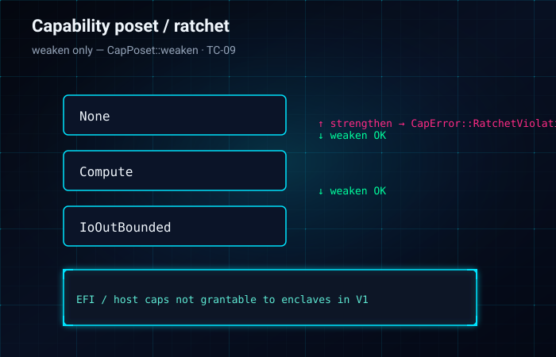

# Purpose

## Why bilkrnl exists

Untrusted compute (agent-generated code, AISec workloads, experimental numerical kernels) needs a place to **run without inheriting trust**. Micro-VMs and TEEs still sit on speculative general-purpose CPUs and often leave residual state. bilkrnl answers: *execute in isolation on a deterministic soft machine, destroy the workspace, then evaluate the artifact as if the run might have been hostile.*

## Goals

1. **Bootable research TCB** on UEFI aarch64 under QEMU/KVM.
2. **6502-style direct execution** — linear address space, per-instruction commit/fault, no speculative interpreter paths ([`SOFTISA.md`](SOFTISA.md)).
3. **Capability poset with forward-only ratchet** — enclaves cannot regain dropped privilege.
4. **Blast chamber (2C)** — always dispose, then ratify against typed predicates (exit, cycles, out, cap ceiling).
5. **Contract stability for 1C** — same `BIL1` images and digests on the C SoftISA body (`softcpu/qemu/bil_isa.c`) and optional QEMU device; host Rust `softcpu` remains an MMIO protocol wrap of `Vm`.
6. **Consumable sealed workloads** — serial `chamber:… RATIFIED <digest>` lines someone else can gate on (policy, `rev4`, `rot4`).

## Non-goals (V1)

- Replacing Linux or shipping a general-purpose OS (**bilOS** is a later userspace story).
- Granting enclaves EFI/MMIO/host pointers.
- Timing-channel hardness on the *host* CPU (accepted risk; 1C moves semantics off the host interpreter path when probed).
- Multi-enclave concurrency (single-flight `EnclaveSlot`).
- FPGA/RTL in-tree (deferred).

## Threat model (sketch)

| Trust | Distrust |
|-------|----------|
| UEFI TCB + SoftISA contracts + chamber predicates | Guest bytecode, residual enclave RAM, “looked fine” runs |
| Host digests / `PARITY.md` goldens | Host speculative side channels across dispose |
| Opt-in C SoftISA when MAGIC matches | Silent replay onto `Vm` after a failed device load |

## Design stance vs Firecracker

Firecracker isolates a *guest kernel*. bilkrnl isolates *bytecode semantics* inside a kernel you control, then refuses to trust the run until chamber ratification. Own kernel is required for linear AS policy, dispose invariants, and a single gated EFI surface later.

## Measured motivation

- Ratchets that matter: **no residual enclave memory after dispose** (TC-14) and **no false RATIFIED after QEMU kill** (TC-12).
- Demo fixtures: sealed policy gate (`PASS\n`, 15 SoftISA ops / TC-15), attested reverse (`rev4` → `!LIB`), attested rotate (`rot4` → `IL1B`).

## Relationship to bil (Bounded Invariant Logic)

[bsommers/bil](https://github.com/bsommers/bil) specifies and proves programs/state machines (GCL, model checking, SMT, Verus). bilkrnl **executes** untrusted bytecode under dispose+ratify. Together: bil proves the policy; bilkrnl enforces it at boot on QEMU/KVM. Integration plan: [`roadmap/bil-integration.md`](roadmap/bil-integration.md).
