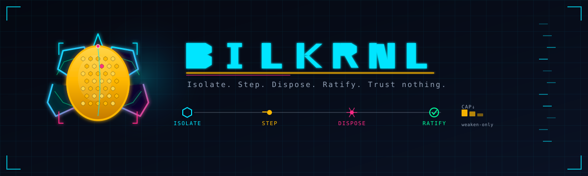

# Documentation Hub

  

Browse the [GitHub Pages showcase](https://nonont1010.github.io/bilkrnl/) or jump in:

| Doc | Description |
|-----|-------------|
| [TOOLING.md](TOOLING.md) | diagrams-as-code + lumagrid notes |
| [PURPOSE.md](PURPOSE.md) | Why bilkrnl exists |
| [ARCHITECTURE.md](ARCHITECTURE.md) | Components and contracts |
| [SOFTISA.md](SOFTISA.md) | SoftISA instruction set datasheet |
| [SOFTISA-GUIDE.md](SOFTISA-GUIDE.md) | SoftISA programmer guide |
| [HOWTO.md](HOWTO.md) | Task recipes |
| [running.md](running.md) | QEMU/KVM how to run |
| [TESTING.md](TESTING.md) | TC matrix |
| [EVIDENCE.md](EVIDENCE.md) | What green verify proves |
| [usermanual/](usermanual/README.md) | Operator manual |
| [diagrams/](diagrams/README.md) | Visual catalog (SVG / Mermaid / draw.io / ASCII) |
| [roadmap/1c-softcpu.md](roadmap/1c-softcpu.md) | Soft-CPU MMIO + C SoftISA |
| [roadmap/bil-integration.md](roadmap/bil-integration.md) | Host-side bsommers/bil specs |
| [specs/bil/enclave_chamber.bil](../specs/bil/enclave_chamber.bil) | Model-checked enclave/chamber |

### Recommended reading order

1. [PURPOSE](PURPOSE.md) → [ARCHITECTURE](ARCHITECTURE.md)
2. [SOFTISA](SOFTISA.md) + [SOFTISA-GUIDE](SOFTISA-GUIDE.md)
3. [running](running.md) → [HOWTO](HOWTO.md)
4. [TESTING](TESTING.md) / [EVIDENCE](EVIDENCE.md)

Graphics are generated by [diagrams-as-code](https://github.com/bsommers/diagrams-as-code) via `scripts/render-graphics.py` (see [TOOLING.md](TOOLING.md)) and refreshed at the end of `scripts/verify.sh`. Interactive charts may use [lumagrid](https://github.com/bsommers/lumagrid) when needed.
