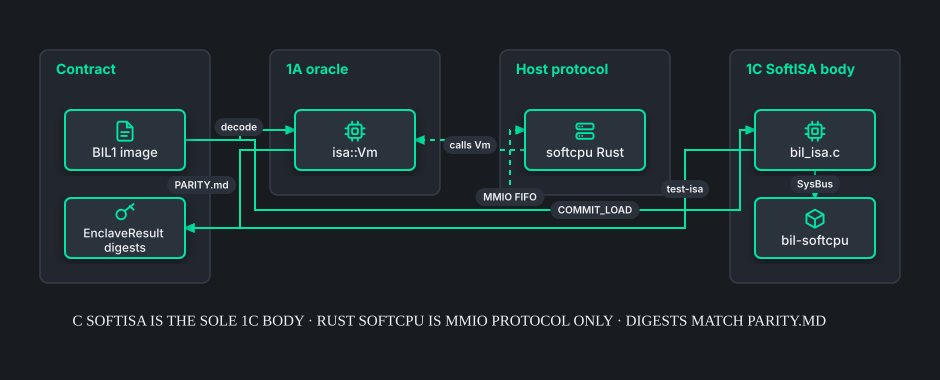

# SoftISA Programmer Guide

[← Documentation hub](README.md) · [Instruction set datasheet](SOFTISA.md)



How to author, assemble, blast, and ratify SoftISA programs. Opcode bytes and digests live in the [datasheet](SOFTISA.md); this guide is the workflow.

## Table of contents

- [Quick mental model](#quick-mental-model)
- [Assemble with bil1asm](#assemble-with-bil1asm)
- [Sealed data prefix pattern](#sealed-data-prefix-pattern)
- [Caps and budgets](#caps-and-budgets)
- [Blast and ratify](#blast-and-ratify)
- [Worked examples](#worked-examples)
- [Chamber serial markers](#chamber-serial-markers)
- [Common mistakes](#common-mistakes)
- [Verify gates](#verify-gates)

---

## Quick mental model

```text
BIL1 image  →  SoftISA run  →  dispose workspace  →  chamber_ratify(result, spec)
                 │
                 └─ digests bind code + out; consumer trusts RATIFIED only
```

- Untrusted code runs on a tiny deterministic machine (Acc + PC + linear RAM).
- After the run, enclave memory is zeroed before anyone ratifies the artifact.
- Someone else’s go-signal is `chamber:… RATIFIED <artifact_digest>`, not “the VM looked fine.”

---

## Assemble with bil1asm

Prefer IR under `tools/bil1asm/examples/`:

```bash
cargo run -p bil1asm -- assemble tools/bil1asm/examples/policy_pass.bil1.ir -o /tmp/policy_pass.bil1
```

Minimal IR shape:

```text
.caps   IoOutBounded
.budget cycles=64 out=8 pages=1
.entry  start

.byte 0x42          ; optional sealed payload before entry
start:
    ld @0
    out
    weaken Compute
    halt
```

Mnemonics map 1:1 to SoftISA opcodes (`ld`/`st`/`ldi`/`addi`/`subi`/`jmp`/`jz`/`out`/`weaken`/`halt`/`nop`). See [`tools/bil1asm/README.md`](../tools/bil1asm/README.md).

Host Rust without the assembler: build `BytecodeImage::new(entry, code, caps, budget)` from a fixture or hand-rolled `Op` bytes ([HOWTO](HOWTO.md)).

---

## Sealed data prefix pattern

Demo workloads put **attested payload bytes at the start of `code`**, with `.entry` past them. Because `code_digest = sha256(code)`, changing sealed bytes changes the digest and breaks ExactBytes ratification for the intended Out.

| Workload | Sealed `@0..` | Entry | Out | Marker |
|----------|---------------|-------|-----|--------|
| Policy gate | candidate `@0` | 1 | `PASS\n` / `FAIL\n` | `chamber:` |
| `rev4` | `BIL!` | 4 | `!LIB` | `chamber:rev4:` |
| `rot4` | `BIL1` | 4 | `IL1B` | `chamber:rot4:` |

Negative twins mutate sealed bytes only (same instruction stream) so the fail spec can ratify a different ExactBytes while the pass spec rejects.

---

## Caps and budgets

1. Start with `IoOutBounded` if the program `out`s.
2. Before `halt`, `weaken Compute` so chamber ceilings of `Compute` can pass (SoftISA still needs `Compute` to execute Halt).
3. Size `max_cycles` / `max_out_bytes` / `max_mem_pages` to the job; chamber `RatifySpec` may tighten further.

Never emit opcodes in `0xE0..=0xEF` to “abort” — that is a host-escape trap, not a feature.

---

## Blast and ratify

```rust
use bilkrnl_core::chamber::{chamber_ratify, demo_rot4_pass_spec};
use bilkrnl_core::enclave::{blast, EnclaveSlot};

let mut slot = EnclaveSlot::new();
let result = blast(&mut slot, img)?;
match chamber_ratify(&result, &demo_rot4_pass_spec()) {
    bilkrnl_core::chamber::ChamberDecision::Ratified { artifact_digest } => { /* pin */ }
    other => panic!("{other:?}"),
}
```

`blast` = load → run → dispose. Inspect `EnclaveResult.{exit,cycles,out,caps_at_exit}` before ratify when debugging rejects ([HOWTO](HOWTO.md#debug-a-chamber-reject)).

---

## Worked examples

### Policy allowlist (branching)

Load sealed candidate, `subi` each allowlist value, `jz` to PASS path; else emit `FAIL\n`. IR: `tools/bil1asm/examples/policy_pass.bil1.ir`.

### Attested reverse (`rev4`)

```text
; sealed BIL! @0..@3; out reverse
ld @3 / out / ld @2 / out / ld @1 / out / ld @0 / out / weaken Compute / halt
```

### Attested rotate (`rot4`)

```text
; sealed BIL1 @0..@3; out left-rotate by one byte → IL1B
ld @1 / out / ld @2 / out / ld @3 / out / ld @0 / out / weaken Compute / halt
```

Full datasheet semantics: [SOFTISA.md](SOFTISA.md).

---

## Chamber serial markers

On UEFI boot the kernel prints one line per sealed job:

```text
chamber: RATIFIED <policy digest>
chamber:rev4: RATIFIED <rev4 digest>
chamber:rot4: RATIFIED <rot4 digest>
```

**Gotcha:** greps for the policy line must match `chamber: RATIFIED` (space after colon) so they do **not** match `chamber:rev4:` / `chamber:rot4:`.

Under `SOFTCPU=1`, also expect `blast: <name> via softcpu` and `softcpu: probed`.

---

## Common mistakes

| Mistake | Result |
|---------|--------|
| Forget `weaken Compute` before Halt under a Compute ceiling | `CapCeilingViolated` |
| `Out` without `IoOutBounded` | `MissingCap` |
| Entry inside sealed data / past `code_len` | load / `PcOob` |
| Emit `E0..=EF` as opcodes | `HostEscapeAttempt` |
| Ratify ExactBytes against wrong Out twin | `OutPredicateFailed` |
| Assume host `softcpu` crate is a second SoftISA | It wraps `Vm`; C `bil_isa.c` is the 1C body |

---

## Verify gates

```bash
./scripts/verify.sh --only unit-isa      # SoftISA unit tests
./scripts/verify.sh --only chamber       # host e2e + goldens
./scripts/verify.sh --only softcpu       # MMIO protocol sim (wraps Vm)
make -C softcpu/qemu test-isa            # C SoftISA body vs PARITY.md
SOFTCPU=1 ./scripts/verify.sh --only softcpu-qemu   # needs forked QEMU build
```

Digest pins: [`softcpu/PARITY.md`](../softcpu/PARITY.md), `tests/system/golden/*.artifact_digest`.
