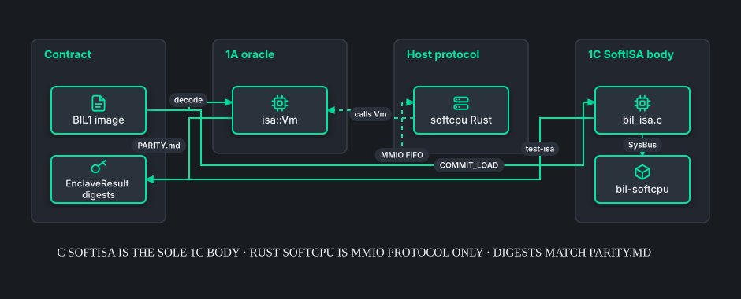

# SoftISA Instruction Set Datasheet

[← Documentation hub](README.md) · [Programmer guide](SOFTISA-GUIDE.md)

> **Canonical bodies:** Rust `bilkrnl-core::isa::Vm` (`bilkrnl-core/src/isa.rs`) and the C port `softcpu/qemu/bil_isa.c`. Digests must match [`softcpu/PARITY.md`](../softcpu/PARITY.md). The host Rust `softcpu` crate is an **MMIO protocol simulator** that wraps `Vm` — it is not a second SoftISA implementation.

## Table of contents

- [Machine model](#machine-model)
- [Opcode map](#opcode-map)
- [Encoding rules](#encoding-rules)
- [Step preamble](#step-preamble)
- [Faults and exits](#faults-and-exits)
- [Capability ratchet](#capability-ratchet)
- [BIL1 image header](#bil1-image-header)
- [Result and digests](#result-and-digests)
- [Reserved host-escape range](#reserved-host-escape-range)
- [Sources of truth](#sources-of-truth)

---

## Machine model

6502-style **direct execution**: one architectural commit per `step`, linear address space, no branch prefetch, no speculative interpreter paths.

| Resource | Type | Notes |
|----------|------|--------|
| `ACC` | `u8` | Accumulator; wraps on `AddImm` / `SubImm` |
| `PC` | `u32` | Fetches from linear RAM; advances through operand bytes |
| Linear RAM | `max_mem_pages × 4096` | Hard ceiling **1 MiB** (`256` pages); code copied to `mem[0..code_len]` at load |
| `out` | bounded FIFO | Cap `IoOutBounded` + `max_out_bytes` |
| Caps | `Cap` | See [capability ratchet](#capability-ratchet) |
| Cycles | `u64` | One charge per `step` (including Halt / Nop / faulting fetch) |

Endianness: multi-byte operands are **little-endian**.

---

## Opcode map

| Mnemonic | Byte | Operands | Effect |
|----------|------|----------|--------|
| `Halt` | `0x00` | — | Exit `Halt` |
| `Nop` | `0x01` | — | No architectural change |
| `LoadImm` | `0x02` | `imm8` | `ACC ← imm8` |
| `Load` | `0x03` | `u16` LE | `ACC ← mem[addr]`; page high-water via `note_addr` |
| `Store` | `0x04` | `u16` LE | `mem[addr] ← ACC` |
| `AddImm` | `0x05` | `imm8` | `ACC ← ACC + imm8` (wrapping) |
| `SubImm` | `0x06` | `imm8` | `ACC ← ACC − imm8` (wrapping) |
| `Jmp` | `0x07` | `u16` LE | `PC ← addr` (`PcOob` if `addr ≥ mem.len`) |
| `Jz` | `0x08` | `u16` LE | If `ACC == 0`, same as `Jmp`; else fall through |
| `Out` | `0x09` | — | Requires `caps ≥ IoOutBounded`; charge 1 out byte; push `ACC` |
| `Weaken` | `0x0A` | `imm8` Cap | `CapPoset::weaken`; bad Cap byte → `IllegalOpcode` |
| *(host trap)* | `0xE0..=0xEF` | — | `HostEscapeAttempt(op)` — **no host side effects** |
| *(other)* | — | — | `IllegalOpcode(op)` |

Assembler IR mnemonics: see [`tools/bil1asm/README.md`](../tools/bil1asm/README.md). Lowering profile: [`roadmap/b3-lowering.md`](roadmap/b3-lowering.md).

---

## Encoding rules

1. Opcode byte, then operands in order (no alignment padding).
2. `Load` / `Store` / `Jmp` / `Jz` addresses are absolute `u16` into linear RAM.
3. Immediate Cap for `Weaken`: `0=None`, `1=Compute`, `2=IoOutBounded`.
4. Data bytes in the sealed region may legally equal `0xE0..=0xEF`; **opcodes** in that range always fault (TC-08). Assemblers must not emit them as opcodes.

---

## Step preamble

Every `Vm::step` / `bil_vm_step`:

1. Charge one cycle → `BudgetExceeded` (no opcode fetch) if over budget.
2. Require `caps ≥ Compute` → else `MissingCap`.
3. Fetch opcode at `PC` → `PcOob` if out of RAM.
4. If opcode ∈ `0xE0..=0xEF` → `HostEscapeAttempt` (before the opcode match).
5. Dispatch; commit or fault. No alternate-path prefetch.

---

## Faults and exits

**`ExitReason`**

| Tag | Meaning |
|-----|---------|
| `Halt` | Clean `Halt` opcode |
| `BudgetExceeded` | Cycle charge failed before/at step |
| `Fault(FaultKind)` | Trap during step |

**`FaultKind`**

| Kind | Typical cause |
|------|----------------|
| `IllegalOpcode(u8)` | Unknown opcode or bad Cap imm |
| `PcOob` | Fetch or jump target ≥ RAM length |
| `MemOob` | Load/Store address OOB or page budget |
| `HostEscapeAttempt(u8)` | Opcode in `0xE0..=0xEF` |
| `MissingCap` | Step without `Compute`, `Out` without IO, or strengthen |
| `OutOverflow` | `Out` exceeds `max_out_bytes` |

---

## Capability ratchet

Poset (weakest → strongest): `None (0) < Compute (1) < IoOutBounded (2)`.

- Every step needs `Compute` (including `Halt`).
- `Out` needs `IoOutBounded`.
- `Weaken` may only move **down or equal** (`CapPoset::weaken`); strengthen → `MissingCap`.
- Successful demo gates typically end at `Compute` after dropping IO (chamber ceiling).

---

## BIL1 image header

`HEADER_LEN = 32`, magic `BIL1`. Max code length **64 KiB**.

| Off | Size | Field |
|-----|------|-------|
| 0 | 4 | magic `BIL1` |
| 4 | 4 | `entry` LE `u32` |
| 8 | 4 | `code_len` LE `u32` |
| 12 | 1 | `initial_caps` (`0/1/2`) |
| 13 | 3 | reserved `0` |
| 16 | 8 | `max_cycles` LE `u64` |
| 24 | 4 | `max_out_bytes` LE `u32` |
| 28 | 2 | `max_mem_pages` LE `u16` |
| 30 | 2 | pad `0` |
| 32… | `code_len` | code (+ optional sealed data prefix) |

Encode/decode: `bilkrnl-core::image::BytecodeImage`.

---

## Result and digests

`EnclaveResult`: `exit`, `out`, `cycles`, `mem_high_water`, `code_digest`, `out_digest`, `caps_at_exit`.

| Digest | Input |
|--------|--------|
| `code_digest` | SHA-256(`code`) only (not the header) |
| `out_digest` | SHA-256(`out`); empty → empty-hash `e3b0c44298…` |
| `artifact_digest` | SHA-256 of `exit_tag \|\| cycles_le64 \|\| out_len_le32 \|\| out \|\| code_digest \|\| out_digest` |

`exit_tag`: `0=Halt`, `1=BudgetExceeded`, `2=Fault`. Framing: `enclave::artifact_bytes` / `artifact_digest`. Chamber ratification: `chamber_ratify` + `RatifySpec`.

---

## Reserved host-escape range

`0xE0..=0xEF` are **never** host/EFI calls. They always fault with `HostEscapeAttempt`. Memory and out must be unchanged by the trap (TC-08). Named parity fixture: `host_escape_e0` in [`PARITY.md`](../softcpu/PARITY.md).

---

## Sources of truth

| Layer | Path | Role |
|-------|------|------|
| 1A oracle | `bilkrnl-core/src/isa.rs` | Authoritative interpreter |
| 1C SoftISA body | `softcpu/qemu/bil_isa.{h,c}` | Independent C port; `make -C softcpu/qemu test-isa` |
| MMIO host sim | `softcpu` crate | Protocol seam; **wraps `Vm`** |
| Guest opt-in | `SOFTCPU=1` + MAGIC `@ 0x0c000000` | QEMU `-device bil-softcpu` |
| Formal sketch | `specs/bil/softisa_step.bil` | Host-side model (not in UEFI TCB) |

Extend the ISA: [HOWTO — Extend the SoftISA](HOWTO.md#extend-the-softisa). Write programs: [SOFTISA-GUIDE](SOFTISA-GUIDE.md).
