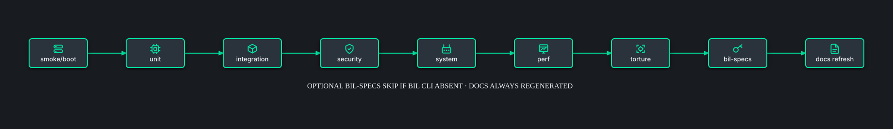

# Testing

## How to run

| Command | Coverage |
|---------|----------|
| `./scripts/verify.sh --quick` | Unit build, kernel build, 1C roadmap, **docs refresh** |
| `./scripts/verify.sh` | All tiers + QEMU + torture + **docs refresh** |
| `./scripts/verify.sh --only unit-cap` | Cap + budget |
| `./scripts/verify.sh --only unit-isa` | Linear AS, faults, outbuf |
| `./scripts/verify.sh --only chamber` | Chamber + host e2e (policy / rev4 / rot4) |
| `./scripts/verify.sh --only boot` | QEMU boot marker |
| `./scripts/verify.sh --only softcpu` | Host MMIO protocol sim |
| `./scripts/verify.sh --only softcpu-qemu` | C SoftISA under forked QEMU |
| `cargo test -p bilkrnl-tests` | All Rust matrix tests |
| `make -C softcpu/qemu test-isa` | C SoftISA body vs PARITY.md |

## Pre-build matrix ↔ files

| ID | Tier | File |
|----|------|------|
| TC-01 | system | `tests/system/test_e2e_harness.rs`, `test_e2e_chamber.sh` |
| TC-02 | system | `tests/system/test_serial_parity.sh` |
| TC-03 | unit | `tests/unit/test_budget.rs` |
| TC-04 | unit | `tests/unit/test_outbuf.rs` |
| TC-05 | unit | `tests/unit/test_linear_as.rs` |
| TC-06 | security | `tests/security/test_image.rs` |
| TC-07 | unit | `tests/unit/test_isa_faults.rs` |
| TC-08 | security | `tests/security/test_no_host_escape.rs` |
| TC-09 | unit | `tests/unit/test_cap_poset.rs` |
| TC-10 | integration | `tests/integration/test_dispose.rs` |
| TC-11 | unit | `tests/unit/test_single_enclave.rs` |
| TC-12 | torture | `tests/torture/test_qemu_kill.sh` |
| TC-13 | unit | `tests/unit/test_chamber.rs` |
| TC-14 | integration | `tests/integration/test_zeroization.rs` |
| TC-15 | perf | `tests/perf/test_cycle_ratchet.sh` |
| TC-16 | system | `scripts/ratify-gate.sh`, `tests/system/test_ratify_gate.sh`, golden `tests/system/golden/policy_pass.artifact_digest` |

## Docs asset gate

`scripts/render-graphics.py` provisions `.venv-docs` with [diagrams-as-code](https://github.com/bsommers/diagrams-as-code), renders `docs/diagrams/*.py` (architecture, blast-chamber, verify-tiers, cap-ratchet, **softisa**), then checks SVG well-formedness and PNG magic. Wired at the end of verify (full and `--quick`). Catalog: [`diagrams/README.md`](diagrams/README.md). Tooling notes (including lumagrid): [`TOOLING.md`](TOOLING.md).

## bil formal specs (optional)

| Command | Behavior |
|---------|----------|
| `./scripts/verify.sh --only bil-specs` | `bil check` + `bil model-check` on `specs/bil/enclave_chamber.bil` |
| Full / `--quick` verify | Same, **skipped** with a note if `bil` / `BIL_BIN` unavailable |

See [`roadmap/bil-integration.md`](roadmap/bil-integration.md).
