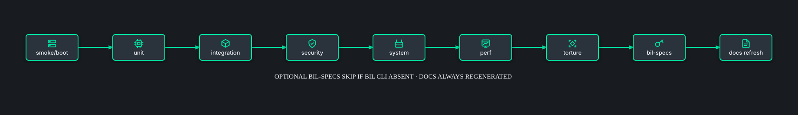

# Running



## Prerequisites

- Rust toolchain with `aarch64-unknown-uefi` target
- `qemu-system-aarch64`
- AAVMF firmware (`/usr/share/AAVMF/AAVMF_CODE.fd`, `AAVMF_VARS.fd`)
- Optional: `inkscape` or ImageMagick for PNG rasterization in docs refresh
- Optional softcpu: prior `./scripts/build-qemu-bil-softcpu.sh` (large local build)

```bash
rustup target add aarch64-unknown-uefi
sudo apt-get install -y qemu-system-arm qemu-efi-aarch64 inkscape
```

## One-shot verify (recommended)

```bash
./scripts/verify.sh --quick   # host tests + kernel build + docs refresh
./scripts/verify.sh           # + QEMU e2e, parity, perf, torture, docs refresh
./scripts/verify.sh --only chamber
./scripts/verify.sh --only softcpu
./scripts/verify.sh --only softcpu-qemu   # SKIP if fork missing
```

## Manual QEMU (stock interpreter)

```bash
cargo build -p bilkrnl --target aarch64-unknown-uefi --release
./scripts/run-qemu.sh
rg 'bilkrnl:|chamber:|cli:' target/qemu-serial.log
```

`run-qemu.sh` stages `bilkrnl.efi` as `ESP/EFI/BOOT/BOOTAA64.EFI`, copies AAVMF vars to `target/AAVMF_VARS.fd`, and boots `-machine virt -cpu cortex-a72 -nographic`.

Expect: `softcpu: absent`, `blast: … via interp`, `chamber: RATIFIED`, `chamber:rev4:`, `chamber:rot4:`, `cli: RATIFIED` (policy digest match), `bilkrnl: halt`.

## Opt-in SoftISA device (`SOFTCPU=1`)

```bash
./scripts/build-qemu-bil-softcpu.sh
SOFTCPU=1 ./scripts/run-qemu.sh
rg 'softcpu:|blast:|chamber:' target/qemu-serial.log
```

Expect: `softcpu: probed`, `blast: … via softcpu`, same digests as stock. Guest probes MAGIC at platform-bus `0x0c000000`.

### Environment

| Var | Meaning |
|-----|---------|
| `INTERACTIVE=1` | Foreground serial (no timeout capture) |
| `TIMEOUT_SEC` | Kill hung QEMU (default 30; verify uses 45) |
| `FIRMWARE_CODE` | Override UEFI code image |
| `BUILD_MODE` | `release` (default) or `debug` |
| `SOFTCPU=1` | Forked QEMU + `-device bil-softcpu` |
| `QEMU_BIN` | Override QEMU binary |
| `SERIAL_LOG` | Capture path (default `target/qemu-serial.log`) |

### Exit / success signals

| Signal | Meaning |
|--------|---------|
| Serial `bilkrnl: ready` | UEFI entry OK |
| `chamber: RATIFIED <64-hex>` | Policy job ratified (TC-16 / ratify-gate) |
| `chamber:rev4:` / `chamber:rot4:` | Sealed attested jobs |
| `cli: RATIFIED` digest == policy chamber | TC-02 serial parity |
| `./scripts/verify.sh` exit 0 | Tiered gates green |
| `ratify-gate.sh` exit 0 | External consumer go-signal only |

## Host-only (no QEMU)

```bash
cargo test -p bilkrnl-tests
cargo test -p softcpu
make -C softcpu/qemu test-isa
```

Exercises the same contracts as the kernel without UEFI. SoftISA authoring: [`SOFTISA-GUIDE.md`](SOFTISA-GUIDE.md).
