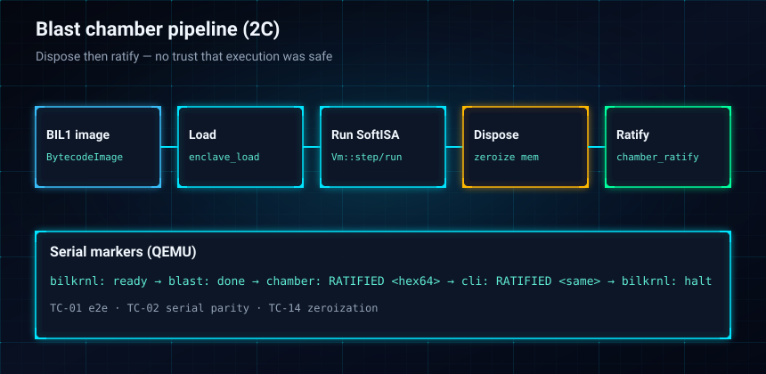
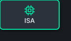
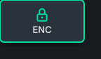
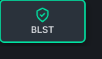
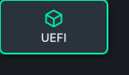

# bilkrnl User Manual

Operator-focused guide. Deep design lives in [PURPOSE](../PURPOSE.md) and [ARCHITECTURE](../ARCHITECTURE.md).



## 1. Install toolchain

```bash
rustup target add aarch64-unknown-uefi
sudo apt-get install -y qemu-system-arm qemu-efi-aarch64
```

## 2. Clone and verify

```bash
git clone https://github.com/nonont1010/bilkrnl.git
cd bilkrnl
./scripts/verify.sh --quick
```

## 3. Watch a blast chamber run

```bash
./scripts/verify.sh --only boot
rg 'chamber:|cli: RATIFIED' target/qemu-serial.log
```

`chamber: RATIFIED` and `cli: RATIFIED` must share the policy digest. Also expect `chamber:rev4:` and `chamber:rot4:` for sealed attested jobs. SoftISA details: [SOFTISA-GUIDE](../SOFTISA-GUIDE.md).

## 4. Interactive serial

```bash
cargo build -p bilkrnl --target aarch64-unknown-uefi --release
INTERACTIVE=1 ./scripts/run-qemu.sh
```

V1 CLI announces: `help enclave-load enclave-run enclave-dispose chamber-ratify blast` and executes the demo `blast` path automatically on boot.

## 5. Write your own fixture (host)

Use `bilkrnl_core::isa::Op` bytes inside `BytecodeImage::new`, then `blast` + `chamber_ratify` with a custom `RatifySpec`. See [SOFTISA-GUIDE](../SOFTISA-GUIDE.md), [SOFTISA datasheet](../SOFTISA.md), and [HOWTO](../HOWTO.md).

## 6. When something fails

| Symptom | Check |
|---------|--------|
| No `bilkrnl: ready` | AAVMF path, EFI copied to `EFI/BOOT/BOOTAA64.EFI` |
| `chamber: REJECT` | Out bytes / budget / exit vs `demo_ok_spec` |
| Verify torture FAIL "kill too late" | Machine too fast — rare; re-run |
| Missing PNGs in docs | Install `inkscape` or `magick`; run `python3 scripts/render-graphics.py` |

## Capability icons

| Icon | Subsystem |
|------|-----------|
|  | SoftISA |
|  | Enclave slot |
|  | Blast chamber |
|  | UEFI boot |
